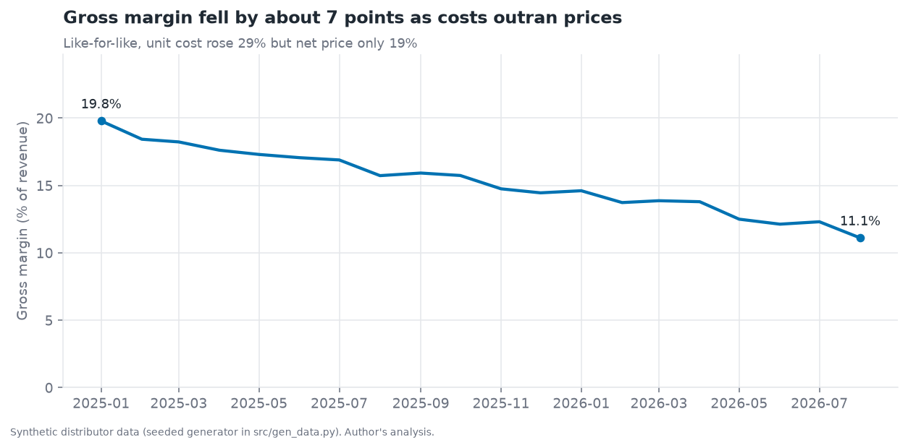
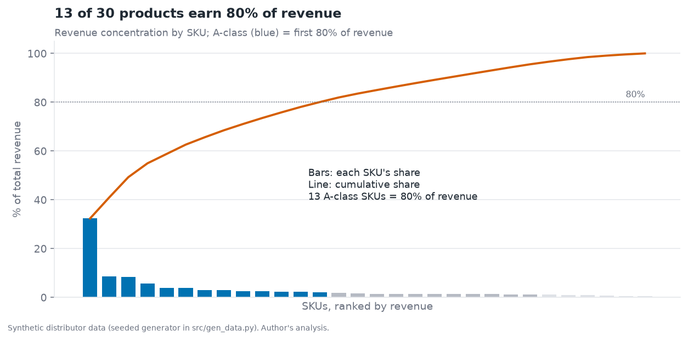
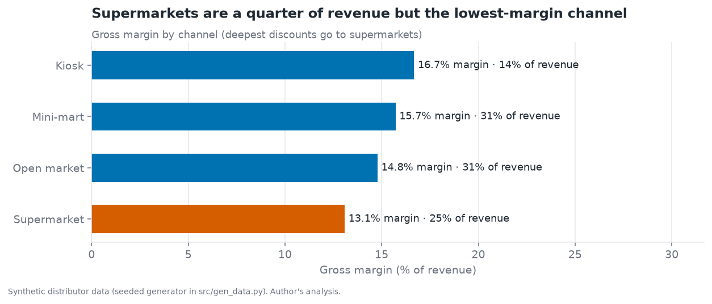
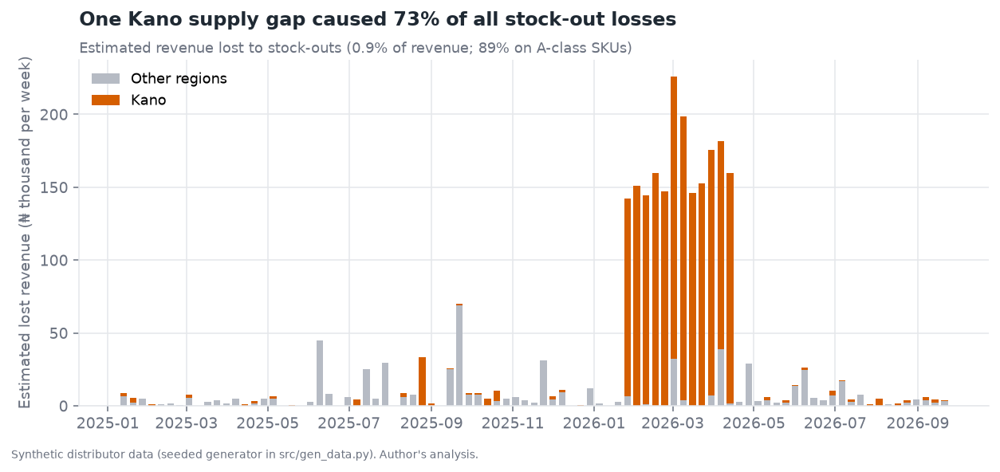
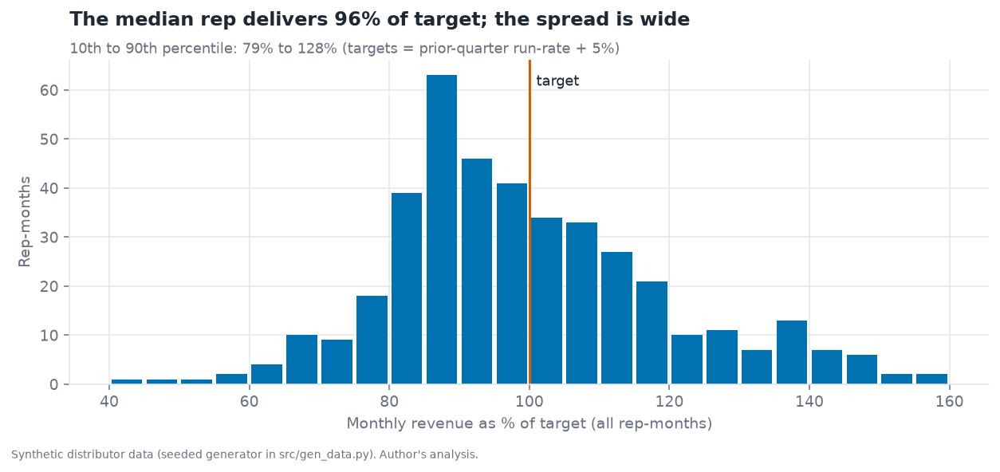

# FMCG Distribution Performance: Margin, Stock-outs and Outlet Retention

> A SQL and Python analysis of a Nigerian FMCG distributor: where margin is leaking, which products and outlets matter, what stock-outs cost, and which retail outlets have quietly stopped buying. Includes estimators checked against known ground truth.

**Author:** Emmanuel Omowumi · [LinkedIn](https://www.linkedin.com/in/emmanuel-omowumi-98bb03139/) · emmanueloluwatobi2015@gmail.com
**Audience:** Head of Sales, Commercial Director, Supply Chain Manager, Finance.

> **Synthetic data, stated openly.** No distributor shares outlet-level data publicly, so this project uses a seeded generator ([`src/gen_data.py`](src/gen_data.py)) that models a 300-outlet distributor in Lagos, Abuja, Kano and Port Harcourt (30 SKUs, 90 weeks, Jan 2025 to Sep 2026, ~105,000 weekly sales lines). The generator **plants five effects** (listed below), so each finding can be checked against the truth. The point of the project is the method and the business reasoning, not the numbers themselves. Input-cost growth (~1.4% a month) is set to the order of magnitude of Nigerian food inflation; see my [Cost-of-Living Tracker](https://github.com/Nuelwumi2024/nigeria-cost-of-living-tracker) for the real NBS data.

## Key findings

| # | Finding | Evidence |
|---|---|---|
| 1 | **Margin has been squeezed by cost pass-through lagging.** | Gross margin fell from 18.8% to 11.8% (about 7 points). Like-for-like, unit cost rose 29% but net price only 19%. |
| 2 | **The biggest product is also the thinnest-margin one.** | 13 of 30 SKUs earn 80% of revenue. Rice 5kg alone is 32% of revenue at a 7.8% margin. |
| 3 | **Supermarkets are a quarter of revenue at a below-average margin.** | 24.7% of revenue at 13.1% margin vs 16.7% for kiosks, because they get the deepest discounts. |
| 4 | **23 outlets have gone silent, worth about ₦9.2M a year.** | Active in weeks 30-60, no purchase in the last 12 weeks. Checked against the generator: all 23 are true lapses. |
| 5 | **One regional supply gap explains most stock-out losses.** | A 12-week Kano gap on the top 5 SKUs ≈ ₦1.9M, 73% of the ₦2.6M estimated loss. About 89% of the loss is on A-class SKUs. |
| 6 | **Sales targets are missed by the typical rep but hit by a minority.** | Median monthly attainment 96%; 10th to 90th percentile 79% to 128%. |
| 7 | **Simple averages forecast weekly category demand well enough.** | One-week-ahead WAPE 4.6% with a 4-week average vs 6.1% for "same as last week". |



## Charts

| | |
|---|---|
|  |  |
|  |  |

## Recommendations

| # | Action | Finding | Size (synthetic data) |
|---|---|---|---|
| 1 | **Reprice to pass costs through faster**, starting with staples (rice, oil, sugar) where margin is under 10%; review prices monthly instead of waiting for a lag. | 1, 2 | Restoring the lost 7 points on the last 26 weeks of sales is worth up to **₦5.8M** (an upper bound: some volume would be lost) |
| 2 | **Cap or tier supermarket discounts** against volume commitments. | 3 | Not sized; test with one account first |
| 3 | **Run a win-back visit list** for the 23 silent outlets, ranked by annual revenue at risk. | 4 | Up to **₦9.2M** a year at risk |
| 4 | **Hold safety stock on the five top SKUs in Kano** and add a stock-out alert (days of cover below 1 week). | 5 | **₦1.9M** lost in one episode |
| 5 | **Reset rep targets** with territory potential and outlet mix, not only last quarter's run-rate. | 6 | Reduces unfair misses and sandbagging |

## How the analysis works

All business logic is SQL ([`sql/analysis.sql`](sql/analysis.sql), DuckDB); Python runs it, validates it and draws the charts.

| Question | Technique |
|---|---|
| Is margin leaking? | Monthly gross margin; like-for-like price vs cost per SKU (first 13 vs last 13 weeks, volume-weighted) |
| Which products matter? | Pareto/ABC analysis with window functions (`sum() OVER`, cumulative share) |
| Which channels and regions pay? | Revenue per active outlet-week and margin by region × channel; outlet deciles |
| Who stopped buying? | Baseline-active definition vs last-12-weeks silence; revenue at risk annualised |
| What did stock-outs cost? | Trailing 26-week baseline on non-stock-out weeks × share of week out of stock × average net price |
| Who is hitting target? | Monthly revenue vs target per rep, **complete months only** (the partial last month is excluded) |
| What will demand be? | One-step-ahead backtest of naive, 4-week and 8-week averages on 13 held-out weeks |

### Checked against ground truth

Because the generator knows what it planted, the estimators can be audited:

| Estimator | Truth | Result |
|---|---|---|
| Lost units from stock-outs | 1,793 units | 1,990 estimated (+11%) |
| Lapsed outlets | outlets with 12+ silent weeks | 100% precision and 100% recall |
| Revenue totals | raw CSV | Three different SQL views reconcile to the raw file exactly (tested) |

### Planted effects

| Effect | In the generator |
|---|---|
| Cost pass-through | Costs +1.4%/month; prices follow 2 months later at 65% pass-through |
| Kano supply gap | Top 5 SKUs out of stock for weeks 55-66 |
| Outlet lapse | ~12% of outlets stop buying after week 45 |
| Seasonality | +25% in December, -8% in January |
| Supermarket discounts | Deepest channel discount |

## Limitations

- **Synthetic data.** Real distributors have returns, credit terms, trade promotions, route costs and messy master data that are not modelled. Effects here are cleaner than in life.
- **Gross margin only.** No logistics, credit or overhead costs, so net profitability is out of scope.
- **Stock-out loss assumes lost sales are not recovered.** Some customers buy later or substitute, so losses are an upper-end estimate.
- **Rep targets are a simple run-rate rule** and not tied to territory potential.
- **The demand backtest covers 13 weeks** of a 90-week history, so it cannot test a full seasonal cycle.

## Power BI

Load the CSVs from `data/raw/` (after generating them) into Power BI, relate `sales` to `outlets`, `products` and `stock`, and use the measures in [`powerbi/measures.dax`](powerbi/measures.dax). Build notes are in [`powerbi/README.md`](powerbi/README.md). No `.pbix` is included.

## Reproduce

```bash
pip install -r requirements.txt
python src/gen_data.py --out data/raw     # 4 seconds, seeded
python src/analysis.py                    # SQL on DuckDB -> data/processed/ + summary.json
python src/make_figures.py                # figures/
pytest -q                                 # 8 tests, including ground-truth checks
```

## Structure

```
sql/analysis.sql     all queries (views, window functions, CTEs)
src/                 gen_data, analysis (runner + validation), make_figures
tests/               8 tests: determinism, integrity, reconciliation, estimators vs truth
powerbi/             DAX measures and model notes
```

## Skills demonstrated

| Skill | Evidence |
|---|---|
| Advanced SQL | CTEs, window functions, cumulative shares, ntile deciles, like-for-like comparisons |
| Commercial thinking | Margin, mix, channel, outlet and rep analysis tied to ₦ recommendations |
| Analytical honesty | Estimators validated against ground truth; limitations stated |
| Data quality | Partial-month exclusion, reconciliation tests |
| Engineering habits | Seeded generator, tests, CI that rebuilds everything |
